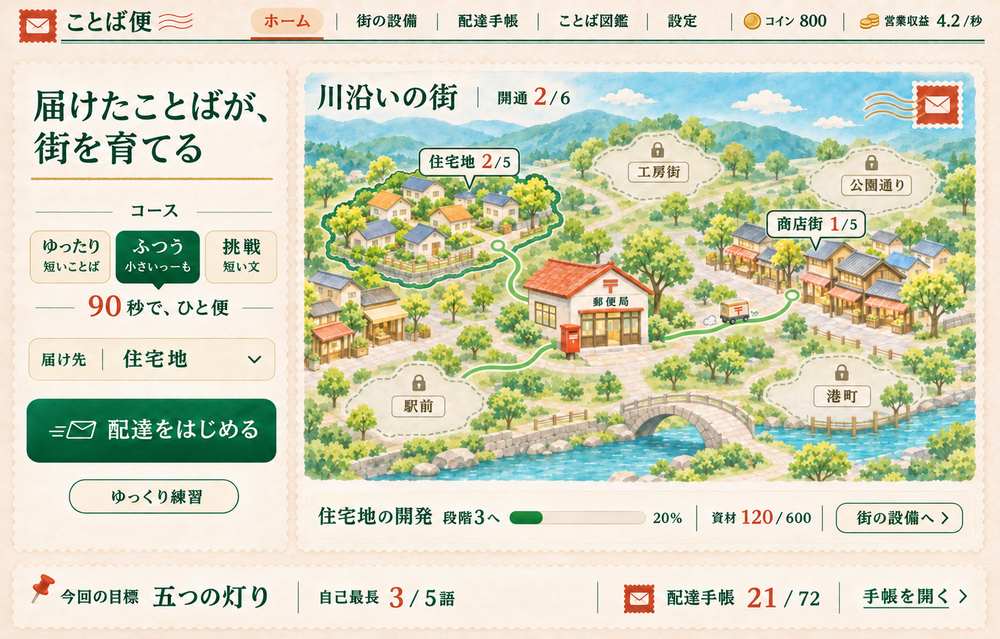
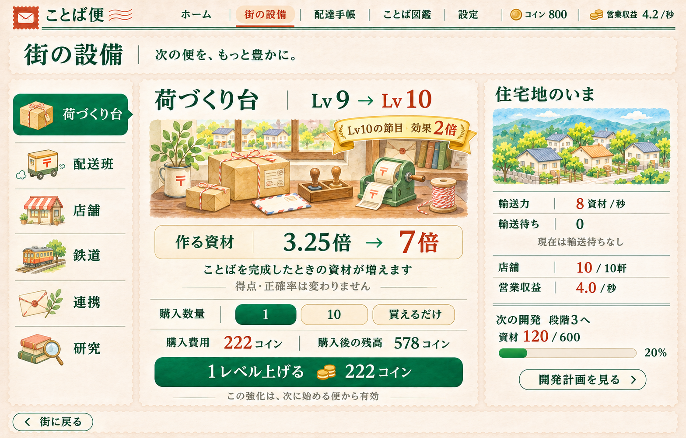
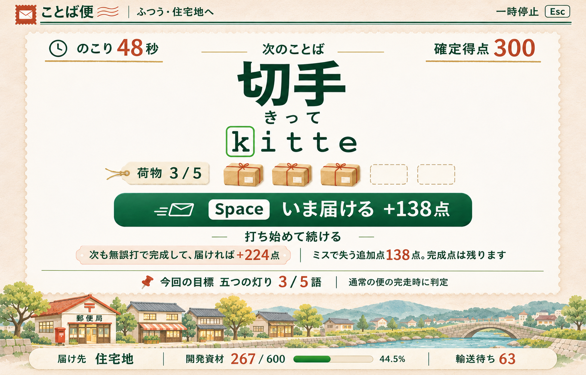
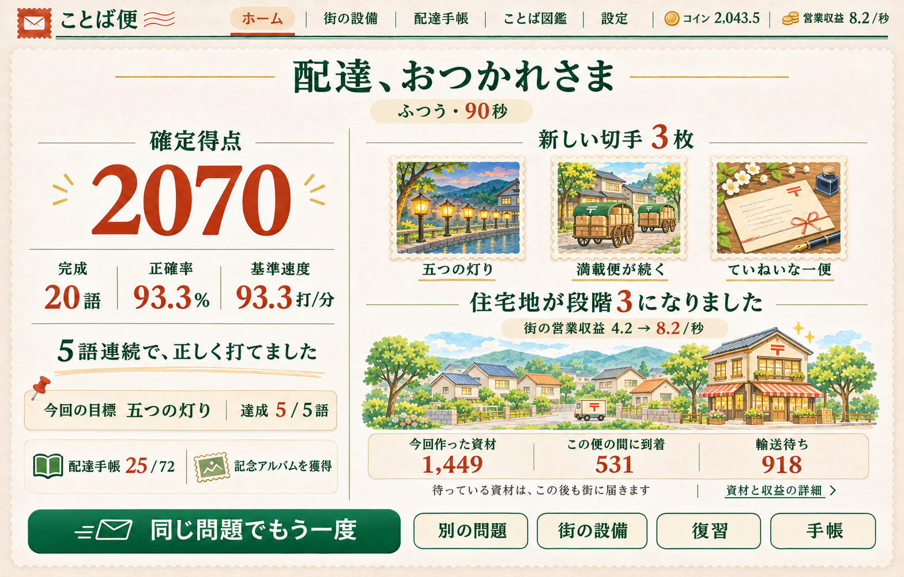
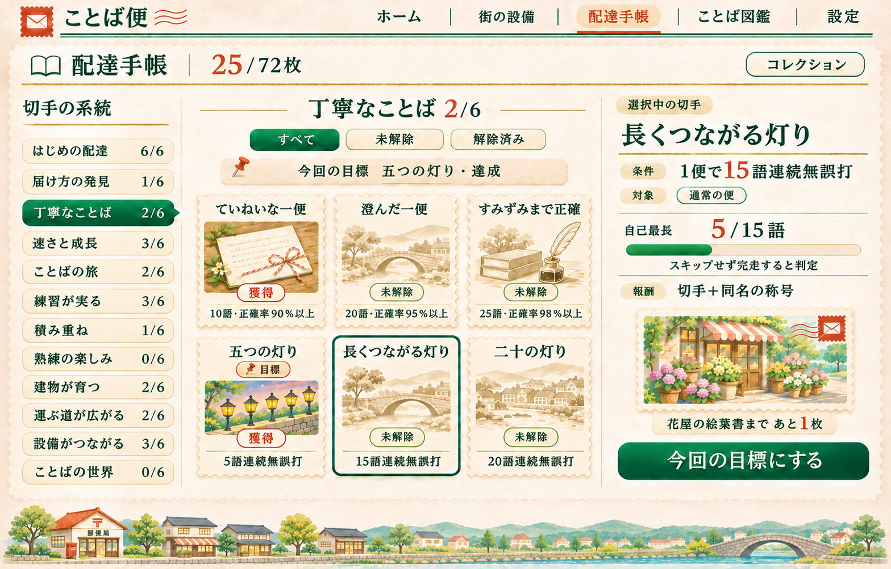

# ことば便 画面設計

版4.1　2026年11月13日

ことば便は、日本語の語や短文を打って資材を届け、街を育てる90秒のWebタイピングゲームである。本書はホーム、設備、本編、結果、配達手帳の代表画面と、図鑑・街の詳細・再出発の操作を定める。プレイヤーのルールは[ゲーム体験仕様書](game_experience.md)、入力・IME・保存・経済計算は[技術仕様書](technical_specification.md)を正とする。

## 1 見た目と読みやすさ

画面は温かな紙色、深い緑、朱色の小さなアクセントで統一する。街は水彩のにじみと紙を重ねた輪郭を持つ小さな日本の街として描く。荷物、切手、帳面、荷づくり台は同じ郵便と文具の表現でそろえ、現実の製品名や既存キャラクターを使わない。

紙の質感は外枠と余白に置き、本文と入力カードは無地にする。文字の後ろへ地図や街を重ねない。街の状態は地図で大きく見せるが、開始操作、入力対象、設備の費用・効果が装飾へ埋もれないようにする。順位表、ログイン、実通貨の購入は画面へ加えない。

| 用途 | 色 | 使い方 |
|---|---|---|
| ページ背景 | #F5F1E7 | 温かな紙色。質感は微量 |
| 入力と本文の面 | #FFFDF7 | 無地の紙 |
| 主文字 | #203D36 | 見出し、入力、本文 |
| 補助文字 | #53625B | 補助説明。読める濃さを保つ |
| 主操作 | #24594F | 白文字の開始・配達・購入・再挑戦 |
| 強調 | #B34E39 | 得点、費用、少数の切手、誤打時の枠 |
| 報酬 | #B58A3C | 箔、建物の灯り。小さい本文には使わない |
| 境界線 | #C9D0C3 | 非入力領域の罫線 |

本文は日本語のサンセリフ、数値とローマ字は読み分けやすい等幅書体を使う。PCの基準画面は1440×900 CSS px、低い基準は1366×768とする。本文16px、見出し24〜32px、入力の日本語48px、読み28px、ローマ字36pxを標準にし、文字拡大では必要な高さを増やす。画像内の文字サイズをCSSの指定値として読み取らない。

主要操作は高さ56px以上、その他の操作は44px以上、フォーカス枠2px、最小間隔8pxとする。色だけで状態を示さず、選択枠、下線、獲得・未解除の文字、ピンを併用する。

## 2 画面と判断の役割

| 画面 | プレイヤーが判断すること | 主操作 | 優先して見せる情報 |
|---|---|---|---|
| ホーム | どのコースで、どの地区へ届けるか | 配達をはじめる | コース、90秒、届け先、現在の開発、地図 |
| 街の設備 | 生成・輸送・営業のどこへ投資するか | 設備を購入する | 費用、購入前後の効果、実際の数量、輸送待ち |
| 本編の語境界 | 今届けるか、次の語を打つか | Spaceで届ける／文字で続行 | 語、読み、荷物、今と次の追加点、残り時間 |
| 結果 | もう一度、復習、街への投資のどれを選ぶか | 同じ問題でもう一度 | 得点、成長、新しい切手、資材と街の変化 |
| 配達手帳 | 何を目指すか、何を得たか | 今回の目標にする | 全72件、12系統、条件、対象、進捗、報酬 |
| 図鑑と練習 | どの語を練習するか | 練習する／本編で試す | 全960語、読み、固定集合、完成・練習資格 |
| 街の詳細 | どの開発を進め、資材をどう配分するか | 計画開始／一時停止／再開 | 開通条件、段階、予約資材、自由在庫 |
| 新しい街 | 今再出発するか、もう少し育てるか | 内容確認後に新しい街へ | 設計図、失うもの、保持するもの、研究の効果 |

通常のヘッダーはホーム・街の設備・配達手帳・ことば図鑑・設定を文字で示す。コインと営業収益は街・設備・結果で見せ、手帳は必要に応じて省略する。本編のヘッダーはタイトル、コース・届け先、「一時停止 Esc」だけにする。コインの連続加算や投資操作を入力の横へ置かない。

## 3 ホームと街の地図

左にコースと開始操作、右に6地区の地図を置く。初見では「何を打って何が増えるか」を理解する前に全設備の説明を読ませない。初回は住宅地の30資材の建築と開始ボタンを中心にし、設備は最初の建物の完成後、輸送能力は輸送待ちが生じた時、研究は再出発が近づいた時に案内する。案内は閉じられ、選択を妨げない。

コースは「ゆったり」「ふつう」「挑戦」の3択で、初期はゆったり。説明は「短いことば」「小さいっ・ーも」「短い文」とする。届け先は開通済み地区から選び、MAINの準備へ入った時点で固定する。途中で地図を押して別地区へ資材を移せない。

地図は中央集配所と6地区を示し、開通済みは彩色した建物と配送路、未開通は淡い土地と条件の入口を示す。選んだ地区に枠と地区名を付け、色だけで選択を表さない。未開通を押すと必要な段階合計、費用、現在値を表示する。列車は鉄道化した路線だけに描く。

代表例は住宅地2/5・商店街1/5、開通2/6、住宅地の段階3計画が120/600資材の状態である。コイン800、街の営業収益4.2/秒、手帳21/72、保存済みコースはふつう。目標「五つの灯り」は自己最長3/5語であり、本編の現在連続数ではない。

開発の外観は段階0の更地、1の最初の建物、2の通り、3の地区の中心施設、4の周辺への広がり、5のまとまった街並みで描き分ける。店舗の軒数は文字で正確に示し、地図の小さな絵を1軒ずつ数える操作を求めない。機能上の段階は資材で進み、切手の枚数だけで機能建物が増えることはない。

## 4 街の設備

左に設備の種類、中央に選択した設備の効果と購入、右に届け先の現在の状態を置く。設備の絵は購入の意味を伝える大きさに留め、倍率と費用を先に読めるようにする。荷づくり台・配送班・店舗・鉄道・連携・研究を同じ入口から閲覧できる。

代表例は荷づくり台Lv9→10の購入前である。資材倍率3.25→7倍、費用222コイン、購入後残高578コインを同時に示す。節目の倍増が基礎値の上昇と重なることが比較で分かるようにする。倍率の詳細を開くと「レベル上昇で基礎倍率3.5、その後に節目の2倍で7」と示し、Lv9の3.25を単純に2倍した値と混同させない。「この強化は、次に始める便から有効」を添える。購入前21枚、購入によりK02が解除されて22枚になる。

| 操作・状態 | 表示と結果 |
|---|---|
| 数量1/10/買えるだけ | 実際の購入数、合計費用、所有数と効果の前後を同時更新 |
| 数量10だが3まで購入可能 | ボタンは「3購入」。10個買えるように見せない |
| 残高不足 | 不足額と次の価格を表示し、購入を無効化 |
| 段階の上限 | 「段階3で上限20軒」等、解決する開発を示す |
| 輸送設備 | 最大輸送力に加え、現在の待ちと追加入荷なしの解消時間を比較 |
| 輸送待ち0 | 「現在は輸送待ちなし」。能力が増えれば直ちに到着量も増えるとは表示しない |
| 鉄道の自由在庫不足 | 予約分と自由在庫を別表示し、計画の一時停止へ進める |
| 節目達成 | 購入完了の効果と切手は自動反映。受取操作を追加しない |

右の住宅地欄は輸送力8資材/秒、輸送待ち0、店舗10/10、住宅地の営業収益4.0/秒、開発120/600とする。ヘッダーの4.2/秒は商店街0.2を含む街全体の値であり、地区の4.0と区別する。MAINの準備・プレイ・停止中に購入画面へ進めず、練習からは終了後に移る。

## 5 本編

無地の入力面を中央に置き、街は下端の小さな景色と一本の状態帯に留める。語、読み、ローマ字、荷物、配達の選択を一つの縦方向の視線移動で読めるようにする。入力中に建物が完成してもレイアウトを動かさず、大きな祝福は結果へ送る。

### 5.1 語境界の例

ふつうコースの「おにぎり、カーテン、コロッケ、食パン」を完成した直後とする。最初の語だけ誤打があり、続く3語は無誤打。基準長7・7・7・9の完成点300、荷物3個の価値230、今の配達ボーナス138である。次は「切手／きって／kitte」、L=5。続けて無誤打で完成した後に配達すれば224点となる。

| 表示位置 | 文言と状態 |
|---|---|
| 左上 | のこり48秒 |
| 右上 | 確定得点300 |
| 入力面 | 次のことば／切手／きって／kitte。最初のkを枠で示す |
| 荷物列 | 荷物3/5。3個の荷物と2個の空枠 |
| 主操作 | Space いま届ける +138点 |
| 続行 | 打ち始めて続ける |
| 次の成功 | 次も無誤打で完成して、届ければ+224点 |
| リスク | ミスで失う追加点138点。完成点は残ります |
| 目標 | 五つの灯り3/5語。通常の便の完走時に判定 |
| 街の状態帯 | 届け先 住宅地／開発資材267/600／輸送待ち63 |

語境界のSpaceでは138点を確保し、次語の位置0のまま続ける。打鍵で続行を選んだら配達ボタンと次の追加点予告を外し、「このことばを完成させよう」へ切り替える。荷物0では配達できるように見せず、5個では自動配達する。

下端の資材表示は得点と単位・場所を分ける。42秒時点では今回作った資材210、到着147、輸送待ち63。開始前の予約120に147が届き、計画267/600となっている。資材の詳細な内訳やコインは入力中に展開しない。

### 5.2 入力中、一時停止、IME

入力済み文字は緑と下線、次の文字は枠、未入力は本文色で示す。誤打では次文字の枠だけを短く朱色へ変え、入力面を揺らさない。保持ボーナスを失っても完成点は減らさず、対応する荷物列と追加点だけを更新する。

一時停止では本編の時計を止め、無地の停止画面に再開、設定、手帳、語を飛ばす、途中終了を置く。街の輸送と営業は実時間で進むことを小さく添える。IME確認では「半角英字でaを入力してください」と示し、確認用aを語の進行へ混ぜない。確認成功後も再開操作を経て戻る。

ライブ解除は入力面外の固定位置に1件だけ置き、語境界で開始する。動き軽減時は切手の輪郭と文字へ置き換える。通知を抑制しても解除・進捗・報酬を止めない。

## 6 結果

結果は得点と入力の成長を左、新しい切手と街の変化を右にまとめる。最も大きい操作は「同じ問題でもう一度」とし、別の問題、街の設備、復習、手帳を補助操作として並べる。画像の表示や祝福の終了を操作の条件にしない。

代表例は2070点、完成20語、正確率93.3%、基準速度93.3打/分、最長連続5語である。基準長合計140の完成点1400に、満載2回の340点と330点を加える。正解140打・誤打10打で正確率140/150、速度140/90×60。新切手は「五つの灯り」「満載便が続く」「ていねいな一便」の3枚で、22→25枚になる。24枚の記念アルバムも同じ確定で獲得する。

街の欄は「住宅地が段階3になりました」「街の営業収益4.2→8.2/秒」を示す。資材は今回作った1,449、この便の間に到着531、届け先の輸送待ち918を別の欄に置く。「待っている資材は、この後も街に届きます」と説明し、詳細で到着には前の便の分を含み得ることを示す。建築の完成と切手枚数を因果で結ばない。

「資材と収益の詳細」では、基本資材と追加資材、到着報酬1,062コイン、営業収益403.5コイン、残高2,043.5、現在の自由在庫を確認できる。本例は中断なしの実経過90秒であり、停止した回の営業を90秒分と呼ばない。

新しい切手は最大3枚、そのほかは件数へまとめる。新着がない回も実際の良かった点と目標の進捗を示す。完成0語は「今回は完成0語」とし、架空の称賛を作らず練習への入口を置く。誤打語がなければ復習操作を出さない。途中終了は通常完走と異なる表示にする。

## 7 配達手帳

左に12系統、中央に選択した系統の6枚、右に選択中の1件の条件を置く。全72件を一面へ縮小表示しない。カードの閲覧と目標固定を別操作にし、別カードを選んでも固定した目標を勝手に変えない。

解除済みは彩色と「獲得」、未解除は低彩度の同一原画と条件、隠し2件はヒントと「条件を見る」で示す。選択カードは枠、固定カードはピンと「目標」、詳細では「今回の目標に設定中」と「目標から外す」を使う。新しいI〜Lも同じルールと密度で見せる。

代表例は25/72、C系統2/6。C01「ていねいな一便」とC04「五つの灯り」が獲得済みで、C04の達成した目標を帯に残す。C05「長くつながる灯り」を閲覧し、条件「1便で15語連続無誤打」、対象「通常の便」、自己最長5/15語、切手と同名の称号、目標にするボタンを表示する。花屋の絵葉書まであと1枚というプレビューはC系統の3件報酬である。詳細の補助文に「この系統であと1枚」と表示し、全体の切手が1枚増えれば得られるとは示さない。この絵葉書は装飾の報酬であり、営業する店舗の建設条件ではない。

| 系統 | 代表例の獲得数 |
|---|---:|
| A はじめの配達 | 6/6 |
| B 届け方の発見 | 1/6 |
| C 丁寧なことば | 2/6 |
| D 速さと成長 | 3/6 |
| E ことばの旅 | 2/6 |
| F 練習が実る | 3/6 |
| G 積み重ね | 1/6 |
| H 熟練の楽しみ | 0/6 |
| I 建物が育つ | 2/6 |
| J 運ぶ道が広がる | 2/6 |
| K 設備がつながる | 3/6 |
| L ことばの世界 | 0/6 |

上部にすべて・未解除・解除済みの絞り込みを置く。H06等の複数コース条件は各コースの達成・不足を並べる。称号と額縁はコレクションで本人が選び、最新の解除で自動装着しない。全解除後は完成台紙と履歴を表示し、追加の日課を自動で作らない。

## 8 ことば図鑑と練習

図鑑は960語を最初から検索・選択できる。コースと6分類に加え、固定集合「初版240語」と状態「未完成」を組み合わせられる。「初版240語・未完成」を選ぶと初版E04の残りを直接練習でき、出題の偶然を待つ必要がない。全件・ゆったり240・ふつう300・挑戦420の完成数も別々に示す。

各行は表示語、読み、コース、完成状態を示し、選択すると同じ書体の入力カードを開く。練習は時計を「時間制限なし」にし、完成後にもう一度・次の語・本編で試すを並べる。語別の無誤打成功は0/3〜3/3で表示する。未完成フィルターでは次の未完成語へ順送りできる。途中の「次の語」は現在の連続成功が途切れることを操作付近で知らせる。

練習中にも基本資材と確定ボーナス資材を同じ規則で生成するが、練習の入力成績と本編の通常記録は分ける。設備を見る場合は練習を終了する。短い語を繰り返す練習でも進歩が消えず、図鑑の異なる語数は同じIDを重複加算しない。

## 9 街の詳細、帰還、再出発

地区の詳細は現在の段階、次の必要資材と前払いコイン、計画の予約資材、自由在庫、輸送待ちを示す。開始・一時停止・再開を状態に応じて出し分ける。一時停止は予約を捨てる操作ではなく、その後の到着を自由在庫へ回す操作であると短文で伝える。

鉄道化は地区段階3・配送班10・コイン・自由在庫の4条件をそれぞれ表示する。満たした条件はチェック、未達は現在値/必要値を示す。輸送待ちを短くする購入前後の見込みには「新しい資材を追加しない場合」を添える。地図の列車を増やす演出は、購入確定後に行う。

帰還画面は適用した留守時間、到着資材、営業収益、完成した計画を一枚にまとめる。最大8時間であることを示し、表示を開いた時点で自動反映済みとする。閉じる前後で同じ収益を再加算しない。最初の長時間帰還では、増えたコインで生成・輸送・営業のどこを強めるかを比較できるようにする。

「新しい街」は条件達成後の任意操作で、初回は設計図3枚から研究を選べる。確認画面は現在の街の6地区条件・到着累計・獲得設計図・次の枚数境界を示す。資材、コイン、設備、計画、輸送待ち、連携が初期化される一方、研究、未使用設計図、切手、図鑑、練習資格、記録、設定は残ることを明記する。戻るを初期選択にし、確定操作と同じ場所へ再出発後の購入ボタンを重ねない。川沿い・海辺・高原は景観の選択で、経済上の優劣を付けない。

## 10 幅、状態、実装へ渡すもの

| 基準画面 | 配分と寸法 | 読む順序 |
|---|---|---|
| ホーム | 余白32px、本文最大1376px、左32%・右68% | コース・届け先→開始→街の計画 |
| 設備 | 余白24px、左15%・中央53%・右32% | 設備→効果の前後→価格→購入 |
| 本編 | 余白32px、入力面の幅760pxを目安 | 語→読み→次キー→荷物→配達の選択 |
| 結果 | 余白24px、左38%・右62%、下に操作列 | 得点→入力の成長→街と切手→再挑戦・設備 |
| 手帳 | 余白24px、左16%・中央48%・右36% | 系統→6枚→選択条件→目標固定 |

各比率は列間余白を引いた残り幅へ適用する。960px以上でも表示高が足りなければ画像と装飾を先に減らす。768〜959pxは街や設備の補助列を下へ送り、入力文字を縮めない。手帳のカードは3列から2列へ、詳細は下へ移す。768px未満は練習・図鑑・手帳を1列で使い、本編には必要幅を案内する。

ボタンはhover・focus・activeを線と形でも区別し、Tab移動でフォーカスを見失わない。ガイドOFFでは日本語と読みを保持し、空いたローマ字領域へ飾りを入れない。保存できない場合は「この回の街と切手は、ページを閉じると残りません」をHOMEと手帳で示し、保存中・保存済み・今回のみを混同しない。

代表画像は構成と美術の参照図であり、実行中のブラウザーを撮ったものではない。機能上の文字、点数、残り時間、ボタン、進捗はDOMへ実装し、画像の文字を切り出して使わない。景色、切手の絵、紙の飾りを表示層で分ける。画像の画素数とCSS pxを同一視しない。

進捗バーはcurrent/targetを0〜1へ制限してDOMの幅に変換する。実績総数の分母は72、建築は対象計画の必要資材、連続目標はその条件値を使う。数値は記録どおり表示する。[デザイントークン](../data/design_tokens.json)に色、文字、余白、操作サイズ、動き軽減、画像参照をまとめる。

## 11 代表画像と同一プロフィールの数値例

5画面は「ホーム→設備購入→本編→結果→手帳」という同じプロフィールの流れである。ホームと購入前は21枚、荷づくりLv10のK02で22枚、本編のB03・C01・C04で25枚となる。旧15実績にI01・I02・J01・J02・K01・K03の6件が加わった状態から始める。実際の利用者の記録ではなく、検算できる例示状態である。

住宅地は段階2、店舗10、配送班2、段階3計画の予約120。商店街は段階1、店舗1、配送班1、自由在庫640。過去の到着1,000資材は住宅地300、商店街700で、建築消費・予約・自由在庫に一致する。初期800コインは過去の営業を含む合成値で、過去の全購入履歴までを再生した値ではない。

| 時点 | 所持切手 | コイン | 街の営業収益/秒 | 代表状態 |
|---|---:|---:|---:|---|
| ホーム・設備購入前 | 21 | 800 | 4.2 | 荷づくりLv9、計画120/600 |
| 荷づくり購入後・本編開始 | 22 | 578 | 4.2 | Lv10、資材7倍 |
| 本編42秒・4語目完成直後 | 22 | 1,048.4 | 4.2 | 得点300、計画267/600、待ち63 |
| 本編90秒・結果 | 25 | 2,043.5 | 8.2 | 得点2070、住宅地段階3、待ち918 |
| 結果直後の手帳 | 25 | 同時点の状態を参照 | 8.2 | C系統2/6、C05を閲覧 |

20語の完成時刻は8・18・29・42・45・48・51・54・57・60・63・66・69・72・75・78・81・84・87・89秒。2〜6語目、12〜16語目がそれぞれ無誤打の5連続で、6・16語目に満載の自動配達を行う。他の10語は各1誤打。住宅地の計画完成は83.625秒で、営業収益は83.625×4.2＋6.375×8.2=403.5コイン。到着報酬531×2=1,062を合わせ、578+403.5+1,062=2,043.5となる。

出題ID、最短長、誤打、実績、経済イベント、保存可能なスナップショットは[画面数値例](../data/screen_fixtures.json)にまとめる。旧画面に使った20語の基準長と難度帯は第4版でも変わっていない。A04を過去の救済ありの便で取得した履歴と、通常の自己最長3語は両立する。

### 11.1 ホーム

### 11.2 街の設備

### 11.3 プレイ中の語境界

### 11.4 結果

### 11.5 配達手帳

## 12 美術制作の指示

ホームは、紙の余白を十分に取り、中央集配所から住宅地と商店街へつながる水彩の地図を主役にする。未開通の4地区は更地と小さな鍵、開通済みは建物と配送路で描き分ける。住宅地の選択枠は控えめな深緑とし、派手な発光を使わない。左の開始操作を地図よりも押しやすく見せる。

設備は、荷物・ひも・ゴム印・小さな荷札機のある机を描き、購入が何を改善するかを物の姿で伝える。最大の文字は3.25倍→7倍、価格は222コインとする。右の地区情報は罫線で整理し、大きな広告風のカードや購入を急がせる時計を置かない。

本編は、切手・きって・kitteを中央に大きく置く。先頭kの枠、3個の荷物、2個の空枠、Spaceの配達を近接させ、視線が散らないようにする。街の絵は下端、建築の数字は細い帯に限定し、入力文字の背景は無地にする。

結果は、2070点、実際の5語連続、3枚の切手、段階3になった住宅地を落ち着いた祝福でまとめる。五つの灯り、満載の配達車、手紙とペンの切手は色と輪郭をそろえる。建築の変化を噴水や切手枚数の報酬で代用しない。

手帳は、彩色した獲得2枚と淡い未解除4枚を対比し、選択中と目標固定を別の印で示す。12系統の文字を読める密度で並べ、下端の街は細く抑える。絵葉書の花屋を機能設備に見せず、収集物としての縁と名称を付ける。

## 13 設計参考資料

sakurai-skillのui #252は`多すぎるとごちゃつく`、SKILL.md第8章は`タッチを揃える`と記す。本編は入力と配達判断、設備は費用と効果、手帳は6枚の条件というように、同時に読む対象を絞る。紙、文字、街、切手は5画面で共通の描き方を使う。

- [sakurai-skill ui 固定版](https://github.com/kociden/sakurai-skill/blob/913dc46b9dedc5e0b12e3834d25d684cf8213f87/references/ui.md)
- [sakurai-skill SKILL.md 固定版](https://github.com/kociden/sakurai-skill/blob/913dc46b9dedc5e0b12e3834d25d684cf8213f87/SKILL.md)

## 14 個別資材と画面状態

[実績・報酬詳細一覧](achievement_catalog.md)、[街の発展詳細一覧](city_development_catalog.md)、[設備・研究詳細一覧](equipment_catalog.md)を画面の表示対象として使う。個別資材は[画像・アイコン等の一覧](visual_resource_inventory.md)で全件を定め、[実装・合成仕様](resource_implementation.md)で表示寸法と状態を確定する。代表5画像は全体の構成と画風の参照であり、最終の地区配置や部品の接続位置は資材台帳の座標を正とする。

未解除の切手は同じ彩色原画の低彩度プレビューと共通外枠を使い、輪郭専用の画像を作らない。B05・F06の条件公開前だけ固有図を隠す。獲得、仮達成、今回対象外、閲覧中、目標固定、未読を別の意味として表示する。

地区画には店舗数、貨物路線、足場、鍵、数値を描き込まない。6地区の30完成画と共通更地に、代表店舗6、共通足場3、車両10方向原画などを必要に応じて重ねる。原画はこれから制作する個別資材であり、5画面の画像を切り出して代用しない。

全地図は800CSS px以上の幅で表示し、必要幅を取れないときは地区名付きの6項目と選択地区の図へ切り替える。本編・練習・導入の街の帯は、開始時点の送り先の地区画1枚と背景の一部を静止表示する。全地図を細い帯へ縮小せず、車両・路線は省く。6切手を載せる詳細台紙は600×400CSS px以上とし、小さいサムネイルは紋章と完成状態だけを示す。
